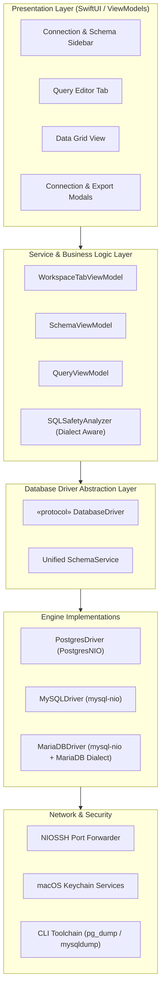

# Business Requirements Document (BRD)
## Project: MySQL & MariaDB Multi-Engine Support for Postgrace
**Document Version:** 1.0.0  
**Status:** In Review / Ready for Approval  
**Owner:** Product & Engineering  
**Target Release:** Postgrace v2.0 (Milestone 1–4)  
**Date:** October 7, 2026  

---

## 1. Executive Summary

### 1.1 Context & Background
Postgrace was originally designed and built as a high-performance, lightweight, native macOS client tailored specifically for PostgreSQL. By leveraging Apple's modern Swift toolchain (SwiftUI, Swift Concurrency, SwiftNIO, and PostgresNIO), Postgrace delivers exceptional speed, instantaneous startup times, minimal memory consumption (<50 MB baseline), and tight macOS HIG (Human Interface Guidelines) integration compared to heavy Electron-based or Java-based tools (e.g., DBeaver, DataGrip) and legacy macOS clients (e.g., Sequel Ace, Sequel Pro).

However, modern software engineering ecosystems are inherently polyglot and heterogeneous. A substantial portion of development teams, backend engineers, and DevOps professionals manage relational workloads spanning both PostgreSQL and MySQL/MariaDB (e.g., WordPress, legacy services, Laravel/PHP applications, microservices, and SaaS backends). 

### 1.2 Problem Statement
Currently, users of Postgrace are constrained exclusively to PostgreSQL. When working with MySQL or MariaDB instances:
1. **Tool Switching Friction:** Users are forced to maintain and juggle separate applications (such as TablePlus, Sequel Ace, or DBeaver) solely for MySQL/MariaDB workflows.
2. **Loss of Native Experience:** Many popular MySQL GUI clients on macOS suffer from sluggish UI rendering, high memory footprints, unmaintained legacy codebases (frequent crashes during SSH tunnels), or expensive subscription licensing models.
3. **Market Expansion Barrier:** Prospective users whose stacks rely partly or entirely on MySQL or MariaDB cannot adopt Postgrace as their primary daily driver.

### 1.3 Solution Overview
Extend Postgrace from a single-engine PostgreSQL tool into a **native multi-engine relational database management studio**, natively supporting **MySQL (5.7, 8.0, 8.4 LTS, 9.x)** and **MariaDB (10.x, 11.x)** while preserving its core identity: ultra-fast, native macOS design, zero-telemetry privacy, and non-blocking asynchronous execution.

---

## 2. Business Objectives & Success Metrics

### 2.1 Strategic Business Goals
* **Market Expansion:** Expand Postgrace's addressable user base by an estimated 250%–300% by tapping into the extensive MySQL and MariaDB developer communities (PHP/Laravel, Go, Python, Ruby on Rails, Node.js, Java, and WordPress).
* **Consolidation as Primary Driver:** Enable developers to make Postgrace their single, all-in-one native database client on macOS without needing companion apps.
* **Preserve Native Performance Advantage:** Ensure that adding MySQL/MariaDB maintains native macOS performance standards (cold start under 1 second, UI render at 120 FPS ProMotion, low memory footprint).

### 2.2 Key Performance Indicators (KPIs)
| Metric | Baseline (Current) | Target (Post-Launch) | Verification Method |
| :--- | :--- | :--- | :--- |
| **Supported RDBMS Engines** | 1 (PostgreSQL) | 3 (PostgreSQL, MySQL, MariaDB) | Engine selector in connection modal & automated test suite |
| **New User Acquisition** | N/A | +150% growth in active downloads / installs within 90 days | App downloads / Homebrew / Release telemetry |
| **Cold Startup Time** | < 0.8s | < 1.0s | Instruments Time Profiler on Apple Silicon |
| **Memory Footprint (Idle)** | ~40–55 MB | < 65 MB with active MySQL session | Activity Monitor / Memory Graph |
| **Query Latency Overhead** | < 5ms vs CLI | < 5ms driver overhead | Query benchmarking vs native CLI / `mysql` |
| **Crash-Free Sessions** | > 99.5% | > 99.5% across SSH & SSL connections | Crash reports / local testing suites |

---

## 3. User Personas & Use Cases

### 3.1 Target Personas
1. **Full-Stack / Backend Engineer (Persona A - "Alex"):**
   - *Profile:* Develops web applications using Laravel, Django, Rails, or Node.js. Uses local MySQL/MariaDB in Docker and remote PostgreSQL in staging/production.
   - *Pain Point:* Annoyed by having to switch between Sequel Ace (for local MySQL) and Postgrace (for Postgres). Wants a consistent keyboard shortcut scheme, dark mode, and query editor experience.
2. **DevOps / Platform Engineer (Persona B - "Brenda"):**
   - *Profile:* Manages cloud infrastructure (AWS RDS Aurora MySQL & Aurora PostgreSQL, Google Cloud SQL). Frequently connects via bastion hosts / SSH jump boxes.
   - *Pain Point:* Requires reliable SSH key authentication, SSL enforcement, safe mode protection against accidental destructive queries, and multi-host color coding.
3. **Database Administrator / Analyst (Persona C - "Carlos"):**
   - *Profile:* Inspects large schemas, exports subsets of data, modifies table structures, monitors row counts, and tests indexes.
   - *Pain Point:* Demands accurate schema introspection (InnoDB table sizes, collations, charsets, foreign key definitions, triggers) without locking production tables.

### 3.2 High-Value Use Cases
* **UC-01:** Connecting seamlessly to local or remote MySQL/MariaDB instances with standard authentication (`caching_sha2_password`, `mysql_native_password`) and custom ports (default `3306`).
* **UC-02:** Secure SSH tunneling using private keys (ed25519/RSA) or password credentials to reach private subnet MySQL servers.
* **UC-03:** Browsing databases, tables, views, stored procedures, functions, triggers, and foreign keys with native sidebar navigation.
* **UC-04:** Exploring and editing tabular data via lazy-scrolling Data Grid with inline cell modifications, transactional rollbacks, and pagination.
* **UC-05:** Writing and executing SQL queries with dialect-specific syntax highlighting, statement splitting, formatting, and auto-complete.
* **UC-06:** Enforcing "Safe Mode" guardrails on production MySQL instances to intercept destructive statements (`UPDATE`/`DELETE` without `WHERE`, `DROP DATABASE`, `TRUNCATE`).
* **UC-07:** Exporting and importing MySQL databases/tables (CSV, JSON, SQL Dumps) natively or via local `mysqldump` / `mysql` toolchain binaries.

---

## 4. Scope of Work

### 4.1 In-Scope
* **Engine Connection Support:**
  * MySQL 5.7, 8.0, 8.4 LTS, and 9.x.
  * MariaDB 10.4 through 11.x.
  * Native Swift protocol driver integration via `mysql-nio` (SwiftNIO-based).
  * Authentication mechanisms: `caching_sha2_password`, `mysql_native_password`, `sha256_password`.
  * TLS/SSL modes: Disabled, Required, Custom CA certificates.
  * SSH Tunneling: Local port forwarding over `NIOSSH` (shared with Postgres).
* **Connection Management UI:**
  * Engine selector (PostgreSQL vs. MySQL vs. MariaDB) with distinctive brand icons.
  * Automatic port defaults (5432 for Postgres, 3306 for MySQL/MariaDB).
  * Storage and retrieval of credentials in macOS Keychain.
  * Color tagging, environment grouping, and Safe Mode settings per connection.
* **Schema Navigation & Introspection:**
  * Information schema introspection for databases/schemas, tables, views, columns, keys, and indexes.
  * Extraction of MySQL storage engine (InnoDB, MyISAM, Memory), table collations, charsets, and live/estimated row counts.
  * Viewing procedures, functions, and triggers.
* **Query Execution & Data Grid:**
  * Multi-tab SQL query editor supporting MySQL syntax and dialect tokens (backtick quoting `` `column` ``, MySQL comments `-- `, `#`, `/* */`).
  * Asynchronous query execution with cancel (`KILL QUERY`) capability.
  * Interactive Data Grid with inline editing, batch commit/discard, filter rules, and sorting.
* **SQL Safety Guardrails:**
  * Adaptation of `SQLSafetyAnalyzer` to recognize MySQL/MariaDB destructive AST patterns.
  * Interception and visual diff warnings for unconstrained updates/deletions.
* **Import / Export Operations:**
  * Client-side CSV and JSON export/import.
  * MySQL SQL dump generation (DDL + DML) and `.sql` file batch execution.
  * Integration with detected local `mysqldump` / `mysql` CLI binaries with progress tracking.

### 4.2 Out-of-Scope (Future Releases)
* Non-relational databases (MongoDB, Redis, SQLite).
* Cloud-proprietary management APIs (e.g., direct AWS RDS API snapshots).
* Visual ER Diagram designer (slated for v2.2).
* Replication topology monitor and cluster failover management (e.g., MySQL Galera Cluster or Vitess orchestrator).

---

## 5. Functional Requirements (FR)

### FR-1: Connection & Authentication Management
* **FR-1.1:** System shall provide a database engine picker in the connection configuration modal with choices: `PostgreSQL`, `MySQL`, and `MariaDB`.
* **FR-1.2:** System shall dynamically set default port to `3306` when MySQL or MariaDB is selected (`5432` for PostgreSQL) while allowing custom overrides.
* **FR-1.3:** System shall support authentication methods including:
  * `caching_sha2_password` (default in MySQL 8.0+).
  * `mysql_native_password` (MySQL 5.7 and legacy systems).
  * `client_ed25519` / MariaDB native password plugins.
* **FR-1.4:** System shall securely persist MySQL connection passwords and SSH tunnel passphrases in the macOS Keychain under dedicated account keys.
* **FR-1.5:** System shall support SSH tunneling (Username + Host + Port + Password or Private Key File) utilizing the existing Swift `NIOSSH` pipeline, binding a local loopback port for the MySQL connection actor.
* **FR-1.6:** System shall allow setting connection-level character sets and collations (defaulting to `utf8mb4` and `utf8mb4_unicode_ci` / `utf8mb4_0900_ai_ci`).

### FR-2: Driver Abstraction & Architecture
* **FR-2.1:** System shall refactor database services behind an abstract `DatabaseDriverProtocol` or `DatabaseSession` actor protocol, providing a unified interface:
  * `connect(config, password) async throws`
  * `disconnect() async`
  * `executeQuery(sql) async throws -> QueryResult`
  * `cancelQuery() async throws`
  * `ping() async throws -> Bool`
* **FR-2.2:** System shall implement `MySQLService` utilizing `mysql-nio` adhering to `DatabaseDriverProtocol`.
* **FR-2.3:** System shall map MySQL data types (TINYINT, SMALLINT, INT, BIGINT, FLOAT, DOUBLE, DECIMAL, VARCHAR, TEXT, LONGTEXT, BLOB, JSON, DATETIME, TIMESTAMP, ENUM, BIT) to Postgrace's standardized `DatabaseValue` model (`.null`, `.bool`, `.int`, `.double`, `.string`, `.data`, `.date`, `.json`).

### FR-3: Schema Introspection & Database Explorer
* **FR-3.1:** System shall introspect all accessible databases via `SHOW DATABASES` or querying `information_schema.schemata`.
* **FR-3.2:** System shall switch active database context via `USE <database>;` when the user selects a database from the sidebar or dropdown.
* **FR-3.3:** System shall fetch tables, views, column details (data type, default value, nullable, auto_increment, collation) from `information_schema.tables` and `information_schema.columns`.
* **FR-3.4:** System shall retrieve index configurations (PRIMARY, UNIQUE, INDEX, FULLTEXT) and foreign key constraints from `information_schema.statistics` and `information_schema.key_column_usage`.
* **FR-3.5:** System shall list stored procedures, stored functions, and triggers from `information_schema.routines` and `information_schema.triggers`.
* **FR-3.6:** System shall provide accurate table size and row count statistics using `information_schema.tables` metadata, with an on-demand live `SELECT COUNT(*)` option.

### FR-4: Query Editor & Execution
* **FR-4.1:** System shall provide syntax highlighting tailored to MySQL/MariaDB reserved keywords, builtin functions, and backtick identifier quoting.
* **FR-4.2:** System shall parse multiple statements separated by semicolons, accounting for MySQL custom delimiters (e.g., `DELIMITER //`).
* **FR-4.3:** System shall support statement execution time tracking, affected rows count (`OK` packet / `affected_rows`), and last insert ID inspection.
* **FR-4.4:** System shall allow canceling running long queries by sending a `KILL QUERY <thread_id>` or closing the connection channel.

### FR-5: Data Grid & Inline Editing
* **FR-5.1:** System shall render tabular query results and table browse views with virtualized lazy scrolling, handling 50,000+ rows smoothly.
* **FR-5.2:** For tables with a Primary Key or Unique Key, system shall allow inline cell editing and generate deterministic `UPDATE` statements formatted with MySQL syntax:
  ```sql
  UPDATE `schema_name`.`table_name` SET `col1` = 'new_val' WHERE `id` = 123;
  ```
* **FR-5.3:** System shall format and display JSON columns with syntax validation and pretty-print popup preview.
* **FR-5.4:** System shall support column filtering and sorting by appending appropriate `WHERE` and `ORDER BY` clauses using MySQL backtick escaping.

### FR-6: SQL Safety & Guardrails
* **FR-6.1:** System shall enforce Safe Mode rules on MySQL connections when enabled:
  * Detect `UPDATE` or `DELETE` statements lacking a `WHERE` clause.
  * Detect `DROP DATABASE`, `DROP TABLE`, `TRUNCATE TABLE`, or `ALTER TABLE ... DROP COLUMN`.
* **FR-6.2:** System shall prompt the user with a destructive action confirmation modal showing a preview of impacted tables and target host tag.
* **FR-6.3:** System shall optionally inject `SET sql_safe_updates = 1;` for session-level enforcement on remote MySQL environments.

### FR-7: Import & Export Tooling
* **FR-7.1:** System shall generate native SQL dumps for selected MySQL tables (DDL with `CREATE TABLE ... ENGINE=InnoDB`, followed by batched `INSERT INTO` statements).
* **FR-7.2:** System shall allow executing external `.sql` dump files with transaction demarcation and error recovery.
* **FR-7.3:** System shall detect local installations of `mysqldump` and `mysql` (Homebrew `/opt/homebrew/bin`, `/usr/local/bin`, MySQL Server paths) and provide accelerated CLI toolchain export/import with live progress bars.

---

## 6. Non-Functional Requirements (NFR)

### NFR-1: Performance & Resource Efficiency
* **P-01:** Cold start time of the application shall not exceed 1.0 second on Apple Silicon (M1 or newer).
* **P-02:** Base memory footprint shall remain below 65 MB with an idle MySQL connection.
* **P-03:** Data Grid virtualization shall maintain 60–120 FPS scrolling performance without UI thread blocking.
* **P-04:** Background queries and schema loads shall execute strictly on detached Swift Concurrency Tasks / Actors to prevent beachballs.

### NFR-2: Security & Privacy
* **S-01:** All database passwords and SSH keys must be stored in macOS Keychain with access control restricted to the Postgrace bundle ID.
* **S-02:** Zero telemetry: Postgrace shall never transmit queries, schema metadata, hostnames, or credentials to external analytics or telemetry endpoints.
* **S-03:** TLS/SSL connections shall support strict verification, custom CA bundles, and cipher suite negotiation matching modern OpenSSL / Apple Crypto standards.

### NFR-3: Usability & User Experience (macOS Native)
* **U-01:** Follow Apple Human Interface Guidelines (HIG) with full support for Dark Mode, Accent Colors, and SF Symbols.
* **U-02:** Provide clear visual differentiation in the sidebar between PostgreSQL (Elephant icon / `#336791`), MySQL (Dolphin icon / `#00758F`), and MariaDB (Sea Lion icon / `#C0765A`).
* **U-03:** Keyboard-first navigation: Full shortcut support for switching tabs (`Cmd+1..9`), running queries (`Cmd+Enter`), running current line (`Cmd+Shift+Enter`), new tab (`Cmd+T`), and cancel query (`Cmd+.`).

### NFR-4: Compatibility & Reliability
* **C-01:** Client operating system: macOS 14.0 (Sonoma) and macOS 15.0 (Sequoia)+.
* **C-02:** MySQL compatibility: MySQL 5.7.x, MySQL 8.0.x, MySQL 8.4 LTS, MySQL 9.x, Percona Server, AWS Aurora MySQL.
* **C-03:** MariaDB compatibility: MariaDB 10.4 through 11.x.

---

## 7. Architectural & Technical Impact

### 7.1 Architecture Evolution: From Postgres-Centric to Multi-Engine
Currently, Postgrace directly ties several components to PostgreSQL types (e.g., `PostgresService`, `PostgresConnection`, `PostgresIdentifier`, `PostgresNIO.PostgresData`). To support MySQL and MariaDB cleanly, the architecture will transition to a Driver Protocol layer:



### 7.2 Core Model & Service Refactoring Plan
1. **`DatabaseEngine` Enum:**
   ```swift
   public enum DatabaseEngine: String, Codable, CaseIterable, Hashable {
       case postgresql = "PostgreSQL"
       case mysql = "MySQL"
       case mariadb = "MariaDB"

       public var defaultPort: Int {
           switch self {
           case .postgresql: return 5432
           case .mysql, .mariadb: return 3306
           }
       }

       public var defaultDatabase: String {
           switch self {
           case .postgresql: return "postgres"
           case .mysql, .mariadb: return "mysql"
           }
       }
   }
   ```
2. **`SavedConnection` Extension:**
   Add `public var engine: DatabaseEngine = .postgresql` with backwards compatibility for existing JSON configuration files.
3. **Identifier Quoting Utility:**
   Abstract `PostgresIdentifier.quote()` into an engine-aware helper:
   - PostgreSQL: Double quotes (`"table_name"`, `"column_name"`)
   - MySQL/MariaDB: Backticks (`` `table_name` ``, `` `column_name` ``)
4. **Swift Dependency Update:**
   Add `https://github.com/vapor/mysql-nio.git` (version 1.8.0+) to `Package.swift`.

---

## 8. Release Roadmap & Phasing

| Phase | Milestone | Scope / Deliverables | Estimated Duration |
| :--- | :--- | :--- | :--- |
| **Phase 1** | **M1: Architecture & Connectivity** | - Refactor `DatabaseDriverProtocol`.<br>- Add `mysql-nio` dependency.<br>- Extend `SavedConnection` with `DatabaseEngine`.<br>- Implement `MySQLDriver` (connect, ping, auth, SSH tunnel, disconnect). | Sprint 1–2 (3 weeks) |
| **Phase 2** | **M2: Schema Introspection & Query Execution** | - Implement MySQL `information_schema` introspection.<br>- Build active database switcher (`USE db`).<br>- Query execution engine mapping MySQL rows to `QueryResult`.<br>- Dialect syntax highlighting & query cancellation. | Sprint 3–4 (3 weeks) |
| **Phase 3** | **M3: Data Grid & Safety Guardrails** | - Inline cell editing with MySQL backtick generation.<br>- Safe Mode rules for MySQL (`UPDATE`/`DELETE` without `WHERE`, `DROP`).<br>- Filter & sorting generator for MySQL. | Sprint 5 (2 weeks) |
| **Phase 4** | **M4: Export/Import, QA & Launch** | - Native CSV/JSON & SQL dump export.<br>- Detect local `mysqldump` & `mysql` toolchain.<br>- Regression testing against Postgres and MySQL 5.7/8.0/8.4 & MariaDB 10/11.<br>- Public release v2.0. | Sprint 6 (2 weeks) |

---

## 9. Risk Assessment & Mitigation Strategies

| Risk ID | Description | Severity | Likelihood | Mitigation Strategy |
| :--- | :--- | :--- | :--- | :--- |
| **R-01** | `caching_sha2_password` authentication failures over non-TLS connections in MySQL 8+. | High | Medium | Implement RSA public key retrieval (`ALLOW_PUBLIC_KEY_RETRIEVAL=true`) or auto-negotiate TLS in `mysql-nio`. |
| **R-02** | Dialect differences between MySQL 8 and MariaDB (e.g. JSON datatype representation, system variables). | Medium | Medium | Maintain separate engine sub-types (`.mysql` vs `.mariadb`) to handle version banners (`SELECT VERSION()`) and syntax divergence gracefully. |
| **R-03** | Performance degradation when loading large databases with 10,000+ tables. | High | Low | Lazy-load table metadata, pagination in sidebar schemas, and fetch column details only on table expansion. |
| **R-04** | Breaking backwards compatibility with existing saved PostgreSQL connections. | Critical | Low | Provide default initializer value `engine: .postgresql` in `SavedConnection` decoder so existing saved profiles load seamlessly. |
| **R-05** | App naming & brand association (Postgrace name strongly implies Postgres). | Medium | High | Maintain "Postgrace" brand identity as the flagship app while marketing subtitle evolves: *"The high-performance native macOS database studio for PostgreSQL, MySQL, and MariaDB"*. |

---

## 10. Open Questions & Stakeholder Sign-Off

### 10.1 Key Open Questions for Decision
1. **Brand Positioning:** Should the application remain branded as *Postgrace*, or should a multi-engine sub-label (e.g. *Postgrace Studio* or *Postgrace Multi-DB*) be introduced? *(Recommendation: Keep the core name Postgrace, update tagline to "Native macOS Database Studio")*.
2. **SQLite Support:** Should SQLite also be included in this cycle, or deferred to v2.1? *(Recommendation: Defer to v2.1 to keep scope focused on network-based relational engines)*.
3. **Stored Procedures / Routine Editor:** Should procedural code editing (PL/pgSQL vs MySQL Stored Procedures) have specialized debugging tools, or syntax highlighting and execution only? *(Recommendation: Focus on syntax highlighting and script execution for v2.0)*.

### 10.2 Document Approval & Sign-Off Matrix

| Role | Name | Status | Date |
| :--- | :--- | :--- | :--- |
| **Product Lead** | Alvin Fadli / Team Lead | Pending Review | — |
| **Lead macOS Engineer** | System Architect | Pending Review | — |
| **QA / Release Engineer** | Testing Lead | Pending Review | — |
