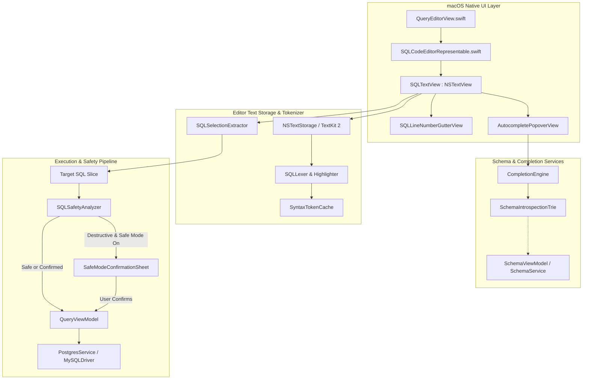

# Business Requirements Document (BRD)
## Project: Query Editor Typing Assists, Syntax Highlighting & Selection Execution
**Document Version:** 1.0.0  
**Status:** In Review / Ready for Engineering Execution  
**Owner:** Product & Engineering (Postgrace Native macOS Database Studio)  
**Target Release:** Postgrace v2.3 (Native SQL Editor Experience)  
**Date:** October 10, 2026  

---

## 1. Executive Summary

### 1.1 Context & Background
Postgrace is a high-performance, native macOS database management studio engineered in Swift and SwiftUI for PostgreSQL and MySQL/MariaDB. A database studio's central interface is its **SQL Query Editor**—the primary workspace where developers, database administrators, and data engineers spend the majority of their time writing, refining, and executing database queries.

In the current implementation, Postgrace relies on SwiftUI's basic `TextEditor(text: $queryText)` wrapped in an `HSplitView`/`VSplitView` layout. While functional for simple, ad-hoc queries, this primitive input component lacks essential code-editing affordances found in modern developer tools (e.g., Xcode, JetBrains DataGrip, VS Code, TablePlus). Specifically, it does not provide:
1. **Intelligent Query Typing Assists:** No context-aware autocompletion for SQL keywords, catalog objects (schemas, tables, views, columns), table aliases, or standard SQL functions.
2. **Real-Time Text Coloring (Syntax Highlighting):** SQL code renders as monochromatic plain text, impairing readability, hindering syntax error spotting, and failing to conform to Postgrace's bespoke pastel design system.
3. **Granular Query Execution (Selection vs. Cursor Bounded vs. Whole Script):** The editor executes the entire text buffer indiscriminately upon pressing `⌘↵`, preventing users from executing a highlighted snippet or running the statement directly under the cursor without clearing or commenting out surrounding code.

### 1.2 Problem Statement
* **High Cognitive Friction & Typo Rates:** Developers must manually remember and type exact schema, table, and column names without autocomplete or fuzzy lookup, causing repetitive syntax errors and query execution failures.
* **Severe Visual Fatigue & Poor Readability:** Without lexical token coloring, complex multi-table joins, nested subqueries, CTEs (`WITH` clauses), and JSON operators blend into a single block of text, increasing debugging time.
* **Destructive Execution Risk on Multi-Statement Worksheets:** When developers keep scratchpads containing multiple queries (e.g., investigative `SELECT` queries alongside an `UPDATE` or `DROP TABLE`), pressing `⌘↵` sends the full buffer or requires manual cut-and-paste. This directly undermines Postgrace’s core **Safe Mode** philosophy.
* **Sub-Optimal Text Editing Performance:** SwiftUI's standard `TextEditor` is not optimized for large SQL migration files (>50,000 lines), lacking custom line gutters, block folding, and low-level text storage control available through AppKit’s `NSTextView` and TextKit 2.

### 1.3 Solution Overview
Transform Postgrace's SQL workspace into a first-class native code editor by engineering a dedicated **Native SQL Editor Engine** backed by AppKit's `NSTextView`, TextKit 2, a lightweight background SQL tokenizer, and schema introspection services:
* **Feature 1 — Context-Aware Typing Assists & Autocomplete:**
  - Fast, debounced schema introspection cache providing instant completions for schemas, tables, views, column names, aliases, and built-in SQL keywords/functions.
  - Smart pair auto-closing (quotes `'`, `"`, brackets `()`, `[]`, backticks `` ` ``).
  - Common SQL snippets & template expansion (`SELECT * FROM`, `JOIN ON`, `INSERT INTO`).
* **Feature 2 — Lexical Text Coloring & Syntax Highlighting:**
  - High-performance, non-blocking tokenization categorizing keywords, clauses, data types, identifiers, literals, operators, comments, and variables.
  - Seamless adaptation to Postgrace's light and dark pastel color tokens with full WCAG AA contrast compliance.
* **Feature 3 — Granular Selection & Cursor-Bounded Execution:**
  - Automatic detection of text selection (`selectedRange`): executing only highlighted SQL text.
  - Cursor-bounded statement isolation: if no text is selected, automatically parse statement boundaries (`--` comments, semicolons `;`) and execute only the current statement at the caret.
  - Dedicated shortcuts: `⌘↵` (Run Selection or Current Statement) and `⇧⌘↵` (Run Entire Script).
  - Tight coupling with `SQLSafetyAnalyzer` and `SafeModeConfirmationSheet` to intercept destructive mutations within the resolved execution slice.

---

## 2. Business Objectives & Success Metrics

### 2.1 Strategic Goals
* **Maximize Developer Velocity:** Reduce keystrokes and context switching by providing sub-15ms auto-completion and schema suggestions directly within the editor.
* **Reinforce Safe Mode Protections:** Guarantee that multi-query worksheets never accidentally execute unselected destructive statements.
* **Deliver True macOS-Native Polish:** Combine Apple HIG keyboard ergonomics, native font metrics (SF Mono / Menlo), smooth trackpad selection, and sub-50MB baseline memory consumption.
* **Zero Main-Thread Latency:** Maintain 60/120 fps butter-smooth typing even in multi-megabyte SQL dump files through background lexical scanning.

### 2.2 Key Performance Indicators (KPIs)
| Metric | Current Baseline | Target (v2.3) | Measurement Method |
| :--- | :--- | :--- | :--- |
| **Autocomplete Suggestion Latency** | None (0%) | $\le 16\text{ ms}$ (within 1 frame) | Profiler timer on keystroke to popup display |
| **Typing Latency (Input Lag)** | Variable (TextEditor) | $\le 8\text{ ms}$ on 10k-line SQL script | Instruments Core Animation / Time Profiler |
| **Syntax Highlighting Refresh** | None (Monochrome) | Background async, zero UI stutter | TextKit 2 tokenization benchmark |
| **Accidental Multi-Statement Executions** | Common user hazard | 0 incidents (explicit selection or cursor bound) | User testing & automated test harness |
| **Large File Load Time (10 MB SQL)** | Hangs / > 3.5s | $< 350\text{ ms}$ with virtualized viewport | Cold file load test suite |
| **Memory Footprint Increase** | 0 MB | $< 25\text{ MB}$ additional editor cache overhead | Memory graph tracking during active sessions |

---

## 3. User Personas & Use Cases

### 3.1 Target Personas
1. **Full-Stack Developer (David):**
   - *Workflow:* Interactively debugging backend APIs against local PostgreSQL. Writes CTEs and complex `JOIN` queries.
   - *Pain Point:* Forgets exact column names and relation aliases (`orders.customer_id` vs `orders.buyer_id`); gets frustrated typing repetitive column lists.
   - *Requirement:* Typing `SELECT o.` immediately pops up columns belonging to `orders` (aliased as `o`).
2. **Site Reliability Engineer / DBA (Elena):**
   - *Workflow:* Investigating production issues over an SSH tunnel. Maintains a single worksheet with 10 diagnostic queries and 1 rollback script.
   - *Pain Point:* Afraid of hitting `⌘↵` in case the entire worksheet executes the rollback command.
   - *Requirement:* Wants to click on line 45 (or select 3 lines) and press `⌘↵`, ensuring only that exact statement runs while Safe Mode protects the rest.
3. **Data Analyst (Marcus):**
   - *Workflow:* Reads and writes 500-line analytical SQL scripts containing aggregations, window functions, and `CASE` statements.
   - *Pain Point:* Hard to read unstructured, monochrome SQL code; misses unclosed quotes or missing commas.
   - *Requirement:* High-contrast pastel syntax highlighting distinguishing functions (`SUM`, `OVER`), literals, keywords, and comments.

### 3.2 User Stories
* **US-01 (Autocomplete):** *As a developer, when I start typing a table or column name, I want an autocomplete popover with fuzzy search so that I can insert the symbol without manual lookup.*
* **US-02 (Alias Resolution):** *As a developer, when I type `FROM customers c WHERE c.`, I want suggestions filtered to columns of the `customers` table so that I write joins faster.*
* **US-03 (Auto-Closing Pairs):** *As a user, when I type an opening quote or parenthesis, I want the closing character inserted automatically and deleted if backspaced over.*
* **US-04 (Syntax Highlighting):** *As a user, I want SQL keywords, strings, comments, numbers, and functions rendered in distinct colors matching Postgrace's theme.*
* **US-05 (Selection Execution):** *As a developer, when I highlight a snippet of SQL, pressing `⌘↵` must execute only the highlighted text and display its specific result set.*
* **US-06 (Cursor-Bounded Execution):** *As a developer, when no text is selected, pressing `⌘↵` must automatically identify the current semicolon-terminated statement containing the cursor and execute only that statement.*
* **US-07 (Run All vs Run Current):** *As a developer, I want distinct visual controls and shortcuts (`⌘↵` for Current/Selected, `⇧⌘↵` for Run All) so that I have absolute control over execution scope.*
* **US-08 (Destructive Query Guard):** *As a user in Safe Mode, if the selected query snippet contains an unbounded `DELETE`, the safety confirmation modal must intercept it before execution.*

---

## 4. Scope of Work

### 4.1 In-Scope (Phase 1 — v2.3)
1. **Editor Architecture:**
   - Migration from SwiftUI `TextEditor` to a bespoke AppKit `NSViewRepresentable` wrapping `NSTextView`, `NSLayoutManager` / TextKit 2, and `NSTextStorage`.
   - Line numbers gutter with active-line highlight and error markers.
   - Monospaced typography with configurable font size (`⌘+`, `⌘-`, `⌘0`).
2. **Query Typing Assists:**
   - SQL keyword completion (ANSI SQL, PostgreSQL, and MySQL dialect keywords).
   - Live schema introspection autocompletion (current database's schemas, tables, views, columns, and types).
   - Contextual table alias resolution (`SELECT t. FROM my_table t`).
   - Built-in SQL functions completion with parameter signature hints (`COALESCE(val1, val2)`, `COUNT(*)`, `DATE_TRUNC('day', timestamp)`).
   - Auto-closing pairs: `()`, `[]`, `{}`, `''`, `""`, `` ``.
   - Smart indentation on `Enter` / newline.
   - Tab completion keybindings (`Tab` or `Enter` to accept, `Esc` to dismiss).
3. **Syntax Highlighting (Text Coloring):**
   - Real-time token classification:
     - Keywords & Reserved Words (`SELECT`, `FROM`, `JOIN`, `WHERE`, `GROUP BY`, `HAVING`, `UNION`)
     - DDL/DML Operators (`INSERT`, `UPDATE`, `DELETE`, `CREATE`, `ALTER`, `DROP`, `TRUNCATE`)
     - Built-in Functions & Aggregates (`COUNT`, `AVG`, `NOW`, `JSON_BUILD_OBJECT`)
     - Data Types (`INT`, `BIGINT`, `VARCHAR`, `TEXT`, `BOOLEAN`, `TIMESTAMP`, `JSONB`, `UUID`)
     - Literals (Strings `'...'`, Numbers `123`, `3.14`, Hex `0x1F`, Booleans `TRUE`/`FALSE`, `NULL`)
     - Identifiers (Table names, Column names, Quoted identifiers `"my_col"`, `` `my_col` ``)
     - Comments (Single line `-- ...`, `/* ... */` multiline)
     - Operators (`=`, `!=`, `<>`, `<=`, `>=`, `LIKE`, `ILIKE`, `IN`, `BETWEEN`, `::`)
   - Adaptive themes: Full synchronization with `PostgraceTheme` (Dark / Light mode).
   - Async background lexing pipeline to prevent UI lockup.
4. **Query Selection & Statement Execution:**
   - Active selection extraction: if `selectedRange.length > 0`, extract `substring(with: selectedRange)`.
   - Smart statement boundary detection (Cursor-Bounded): if `selectedRange.length == 0`, split buffer by SQL statement boundaries respecting comments and quoted strings; select the statement enclosing the current insertion caret.
   - Visual execution gutter flash / highlight indicating which block is executing.
   - Execution scope indicator in the toolbar: "Run Selection (1 statement)" vs "Run Current Statement (Line 12)" vs "Run Entire Script (4 statements)".
   - Integration with `SQLSafetyAnalyzer`: validate the exact targeted statement slice against safe mode rules before dispatching to `PostgresService` / `MySQLDriver`.

### 4.2 Out-of-Scope (Future Iterations)
* Visual Query Builder (drag-and-drop schema designer).
* Full Language Server Protocol (LSP) client via external processes.
* Multi-cursor editing (deferred to v2.4).
* AST-based semantic refactoring (e.g. automated column renaming across queries).

---

## 5. Detailed Functional Requirements

### 5.1 Module 1: Query Typing Assists & Autocomplete (FR-1)

#### FR-1.1: Intelligent Autocomplete Popover
* **Trigger Conditions:**
  - Automatically triggered upon typing 2 or more alphanumeric characters (`[a-zA-Z0-9_]`).
  - Triggered immediately upon typing a period `.` following an identifier or alias (e.g., `users.`, `u.`, `public.`).
  - Manually triggered anywhere via keyboard shortcut `⎋` (Escape) or `^Space` (Control-Space).
* **Popover UI & Positioning:**
  - Floating native macOS popover or custom borderless overlay window pinned below the current cursor text position (`caretRect`).
  - Maximum height: 8 visible rows with smooth vertical scrolling.
  - Item structure:
    - **Icon / Badge:** Distinct colored glyph indicating token type (`[K]` Keyword - Blue, `[T]` Table - Teal, `[V]` View - Cyan, `[C]` Column - Purple, `[F]` Function - Amber, `[S]` Schema - Green).
    - **Primary Text:** Name of the candidate completion with matched characters emboldened.
    - **Detail / Subtext:** Schema qualifier, column data type (e.g., `varchar(255)`, `bigint`, `nullable`), or function signature.
    - **Fuzzy Search & Ranking:** Prioritize exact prefix matches, followed by alias-matched columns, tables in the current `search_path`, standard SQL keywords, and finally fuzzy substring matches.

```
+-------------------------------------------------------------+
| [C] email          varchar(255)  users                      |  <- Selected (Highlighted in Pastel Blue)
| [C] email_verified boolean       users                      |
| [T] email_logs     table         public                     |
| [F] exp()          function      numeric -> numeric         |
+-------------------------------------------------------------+
```

#### FR-1.2: Schema Introspection Integration
* **Data Sources:** Postgrace’s existing `SchemaViewModel` and `SchemaService`.
* **Caching Strategy:**
  - Maintain an in-memory Trie / Prefix-Tree indexed by `(schema, table, column)` and `(keyword)`.
  - Cache is populated upon database connection and refreshed asynchronously whenever a DDL statement (`CREATE TABLE`, `DROP COLUMN`, `ALTER TABLE`) is executed or when the user clicks "Refresh Schema".
  - Invalidation: lightweight timestamp-based cache invalidation per database connection.

#### FR-1.3: Contextual Alias & Scope Resolution
* **Alias Tracking:**
  - The editor's lexical scanner scans backwards from the cursor to detect `FROM <table> <alias>` or `JOIN <table> AS <alias>`.
  - If the user types `<alias>.`, the completion provider filters candidates strictly to columns belonging to `<table>`.
* **Schema Namespace Resolution:**
  - If the user types `<schema>.`, candidate suggestions are strictly tables, views, and functions belonging to `<schema>`.

#### FR-1.4: Auto-Closing Pairs & Structural Helpers
* **Pair Matching:**
  - Typing `'` inserts `''` with caret positioned inside.
  - Typing `"` inserts `""` with caret positioned inside.
  - Typing `(` inserts `()` with caret positioned inside.
  - Typing `[` inserts `[]` with caret positioned inside.
  - Typing `` ` `` inserts ```` `` ```` with caret positioned inside.
* **Smart Backspace (Deletion):** If the caret is between empty matching pairs (e.g., `('|')`), pressing `Backspace` deletes both characters.
* **Auto-Indent:** Pressing `Enter` after an unclosed parenthesis or block keyword (`BEGIN`, `CASE`) automatically indents the next line by 4 spaces (or 1 tab, based on user preference).

---

### 5.2 Module 2: Text Coloring & Syntax Highlighting (FR-2)

#### FR-2.1: Token Classification & Grammar Specification
The lexical tokenizer must recognize and categorize tokens into distinct semantic roles:
1. **SQL Keywords:** `SELECT`, `FROM`, `WHERE`, `AND`, `OR`, `NOT`, `ORDER BY`, `GROUP BY`, `HAVING`, `LIMIT`, `OFFSET`, `JOIN`, `LEFT`, `RIGHT`, `INNER`, `OUTER`, `CROSS`, `FULL`, `ON`, `AS`, `UNION`, `ALL`, `DISTINCT`, `WITH`, `RECURSIVE`, `CASE`, `WHEN`, `THEN`, `ELSE`, `END`, `EXISTS`, `IN`, `BETWEEN`, `LIKE`, `ILIKE`, `IS NULL`, `IS NOT NULL`.
2. **DDL & DML Commands:** `INSERT INTO`, `VALUES`, `UPDATE`, `SET`, `DELETE`, `TRUNCATE`, `CREATE`, `ALTER`, `DROP`, `TABLE`, `VIEW`, `INDEX`, `SCHEMA`, `DATABASE`, `TRIGGER`, `FUNCTION`, `PROCEDURE`, `SEQUENCE`, `GRANT`, `REVOKE`, `BEGIN`, `COMMIT`, `ROLLBACK`.
3. **Data Types:** `INTEGER`, `INT`, `SMALLINT`, `BIGINT`, `SERIAL`, `BIGSERIAL`, `DECIMAL`, `NUMERIC`, `REAL`, `DOUBLE PRECISION`, `VARCHAR`, `CHAR`, `TEXT`, `BOOLEAN`, `BOOL`, `DATE`, `TIME`, `TIMESTAMP`, `TIMESTAMPTZ`, `INTERVAL`, `JSON`, `JSONB`, `UUID`, `BYTEA`, `ARRAY`.
4. **Built-in Functions:** `COUNT`, `SUM`, `AVG`, `MIN`, `MAX`, `COALESCE`, `NULLIF`, `ROUND`, `FLOOR`, `CEIL`, `CONCAT`, `SUBSTRING`, `LOWER`, `UPPER`, `LENGTH`, `TRIM`, `NOW`, `CURRENT_TIMESTAMP`, `DATE_TRUNC`, `EXTRACT`, `JSON_AGG`, `ROW_TO_JSON`, `GEN_RANDOM_UUID`.
5. **Literals:**
   - Single-quoted strings: `'hello world'`, with escaped quotes `''` or `\'`.
   - Dollar-quoted strings (PostgreSQL): `$$hello$$` or `$tag$body$tag$`.
   - Numbers: Integers (`42`), Floats (`3.14159`), Scientific (`1e-6`), Hex (`0xFF`).
   - Booleans & Null: `TRUE`, `FALSE`, `NULL`.
6. **Identifiers & Namespaces:**
   - Double-quoted identifiers: `"Users"`, `"order items"`.
   - MySQL backtick identifiers: `` `users` ``, `` `order_date` ``.
   - Standard bare identifiers: schema, table, and column names.
7. **Comments:**
   - Single line: `-- comment text` and `# comment text` (MySQL).
   - Multi-line block: `/* block comment */` with nesting support.
8. **Operators & Punctuation:**
   - Arithmetic: `+`, `-`, `*`, `/`, `%`, `^`.
   - Comparison: `=`, `!=`, `<>`, `<`, `>`, `<=`, `>=`.
   - Bitwise & Pattern: `~`, `~*`, `!~`, `||`.
   - PostgreSQL Type Cast: `::`.

#### FR-2.2: Pastel Theme Color Palette Mapping
In compliance with `PostgraceTheme` and the existing macOS Pastel Design System:

| Token Category | Dark Mode Hex | Light Mode Hex | Visual Rationale |
| :--- | :--- | :--- | :--- |
| **SQL Keywords** | `#93C5FD` (Pastel Sky Blue) | `#2563EB` (Royal Blue) | Crisp distinction for structural SQL clauses |
| **DDL/DML Commands** | `#FCA5A5` (Pastel Coral/Rose) | `#DC2626` (Crimson) | Subtle visual prominence for mutating verbs |
| **Data Types** | `#A7F3D0` (Pastel Mint/Emerald) | `#059669` (Forest Mint) | Clear differentiation for schema definitions |
| **Built-in Functions** | `#FDE047` (Pastel Amber/Yellow) | `#D97706` (Warm Ochre) | Distinct highlight for computational calls |
| **String Literals** | `#FDBA74` (Pastel Peach/Orange) | `#C2410C` (Rust Orange) | Standard contrast for string data |
| **Numeric Literals** | `#C4B5FD` (Pastel Lavender) | `#7C3AED` (Deep Violet) | Immediate recognition of numerical constants |
| **Identifiers** | `#E2E8F0` (Soft White/Slate) | `#1E293B` (Dark Slate) | High readability for schema and column names |
| **Comments** | `#64748B` (Muted Slate / 50% opacity)| `#94A3B8` (Cool Grey) | Demoted visual hierarchy, zero distraction |
| **Operators & Casts** | `#F472B6` (Pastel Pink) | `#DB2777` (Deep Magenta)| Clear distinction for operational logic |

#### FR-2.3: Non-Blocking Background Parsing
* Parsing must be executed on a dedicated background actor/queue.
* Only the visible line range plus a buffer of 100 lines above and below viewport (`visibleRange`) receives immediate synchronous layout styling; full-document tokenization is debounced by 50ms and applied asynchronously to `NSTextStorage`.

---

### 5.3 Module 3: Query Selection & Statement Execution (FR-3)

#### FR-3.1: Execution Scope Resolution Hierarchy
When an execution action is triggered, Postgrace must evaluate execution scope in three deterministic steps:

$$\text{Execution Scope} = \begin{cases} 
\text{Selected Text} & \text{if } \text{selectedRange.length} > 0 \\ 
\text{Cursor-Bounded Statement} & \text{if } \text{selectedRange.length} == 0 \text{ and statement exists at caret} \\ 
\text{Entire Editor Buffer} & \text{if explicitly triggered via Run All (} \Uparrow\mathbf{\mathscr{⌘}}\hookleftarrow \text{)} 
\end{cases}$$

```
+---------------------------------------------------------------------------------------------------+
| SQL Script in Editor                                                                              |
|                                                                                                   |
| 1 | -- Step 1: Health check                                                                       |
| 2 | SELECT * FROM pg_stat_activity;                                                               |
| 3 |                                                                                               |
| 4 | -- Step 2: User profile inquiry (Caret is at line 5)                                          |
| 5 | SELECT id, email, created_at                                    <-- [CURSOR HERE]             |
| 6 | FROM users                                                                                    |
| 7 | WHERE status = 'active';                                                                      |
| 8 |                                                                                               |
| 9 | -- Step 3: Cleanup old tokens                                                                 |
| 10| DELETE FROM user_tokens WHERE expired_at < NOW();                                             |
+---------------------------------------------------------------------------------------------------+
  Action: User presses ⌘↵ without selecting text.
  Result: Postgrace bounds Lines 5-7, highlights Lines 5-7 with a subtle blue gutter pulse,
          and sends ONLY "SELECT id, email, created_at FROM users WHERE status = 'active';"
          to QueryViewModel.
```

#### FR-3.2: Statement Boundary Parser (Cursor-Bounded Extraction)
* **Algorithm Requirements:**
  - Token-aware statement boundary scanner (cannot simply do `.components(separatedBy: ";")`).
  - Must ignore semicolons inside single-quoted strings (e.g. `'hello; world'`).
  - Must ignore semicolons inside dollar-quoted strings (e.g. `$$ SELECT 1; $$`).
  - Must ignore semicolons inside comments (e.g. `-- Run this next; important`).
  - Identifies statement starting offset (immediately following preceding semicolon or start of file) and ending offset (the terminating semicolon or end of file).
  - Skips leading and trailing empty whitespace/comments.

#### FR-3.3: Selection Extraction
* If the user selects text across lines (or even part of a line, e.g. `SELECT * FROM users`), Postgrace extracts:
  $$\text{targetSQL} = \text{queryText}[\text{selectedRange}]$$
* The toolbar execution button dynamically updates its label and tooltip:
  - If text is selected: **`Execute Selection (⌘↵)`**
  - If no text selected: **`Execute Current (⌘↵)`**
  - Dropdown menu provides explicit: **`Execute Entire Script (⇧⌘↵)`**

#### FR-3.4: Safe Mode Interception of Resolved Query Slice
* **Crucial Security Rule:** The `SQLSafetyAnalyzer` must evaluate **only the target resolved query slice**, not the entire inactive buffer!
* *Example:* If the user has `DROP TABLE archive_logs;` on line 10, but highlights `SELECT count(*) FROM archive_logs;` on line 1, Postgrace evaluates safety on the `SELECT` query.
* Since the selected query is a read-only `SELECT`, it executes **immediately without interrupting the user**.
* Conversely, if the user highlights or places the cursor on line 10 (`DROP TABLE`), `SQLSafetyAnalyzer` detects the destructive action and presents `SafeModeConfirmationSheet`.

#### FR-3.5: Execution Feedback & Visual Gutter Flash
* When a query begins executing:
  - An animated blue indicator appears in the line gutter next to the lines being executed.
  - The editor background behind the active statement displays a 5% opacity tint of `accentSky` that fades out smoothly over 400ms upon query completion.
  - Status bar displays: `Executing statement at lines 5–7...` or `Executing selected 42 characters...`.

---

## 6. Architecture & Implementation Design

### 6.1 Architectural Component Overview



### 6.2 AppKit `NSTextView` Implementation Details
SwiftUI’s `TextEditor` does not support custom text storage delegate hooks, line gutter views, or custom autocomplete popovers anchored to caret coordinates. Postgrace will introduce:

1. **`SQLCodeEditorRepresentable` (`NSViewRepresentable`):**
   - Bridges SwiftUI state (`@Binding var text: String`, `@Binding var selectedText: String?`) to AppKit.
   - Hosts an `NSScrollView` with `SQLTextView` and `SQLLineNumberGutterView`.
2. **`SQLTextView` (`NSTextView` Subclass):**
   - Configured with `isAutomaticQuoteSubstitutionEnabled = false`, `isAutomaticDashSubstitutionEnabled = false`, and `isAutomaticSpellingCorrectionEnabled = false`.
   - Overrides `keyDown(with:)` for:
     - `⌘↵`: Execute selected or current statement.
     - `⇧⌘↵`: Execute entire script.
     - `Tab`: Accept selected autocomplete suggestion or indent 4 spaces.
     - `Esc`: Toggle autocomplete popover or dismiss.
     - Auto-closing pair insertion on `'`, `"`, `(`, `[`, `` ` ``.
   - Overrides `insertNewline(_:)` for smart line indentation.
3. **`SQLLineNumberGutterView` (`NSRulerView` Subclass):**
   - Renders line numbers in `SF Mono` with 11pt font size.
   - Highlights the line number where the cursor currently resides.
   - Displays breakpoint / execution pulse indicator during query runs.

### 6.3 SQL Selection Extractor Logic
The `SQLSelectionExtractor` handles robust statement boundary parsing:

```swift
public struct SQLSelectionSlice {
    public let sql: String
    public let range: NSRange
    public let executionMode: ExecutionMode
}

public enum ExecutionMode {
    case selection
    case cursorBounded(lineNumber: Int)
    case fullScript
}

public final class SQLSelectionExtractor {
    /// Extracts the target SQL based on current selection or caret position.
    public static func extract(
        from fullText: String,
        selectedRange: NSRange,
        caretLocation: Int
    ) -> SQLSelectionSlice {
        // 1. Explicit text selection
        if selectedRange.length > 0 {
            let nsString = fullText as NSString
            let selectedSQL = nsString.substring(with: selectedRange)
            return SQLSelectionSlice(
                sql: selectedSQL.trimmingCharacters(in: .whitespacesAndNewlines),
                range: selectedRange,
                executionMode: .selection
            )
        }
        
        // 2. Cursor-bounded statement discovery
        let statements = SQLScriptSplitter.splitWithRanges(fullText)
        for stmt in statements {
            if stmt.range.contains(caretLocation) || stmt.range.upperBound == caretLocation {
                return SQLSelectionSlice(
                    sql: stmt.text.trimmingCharacters(in: .whitespacesAndNewlines),
                    range: stmt.range,
                    executionMode: .cursorBounded(lineNumber: stmt.startLine)
                )
            }
        }
        
        // 3. Fallback to entire buffer if no boundary found
        return SQLSelectionSlice(
            sql: fullText.trimmingCharacters(in: .whitespacesAndNewlines),
            range: NSRange(location: 0, length: (fullText as NSString).length),
            executionMode: .fullScript
        )
    }
}
```

### 6.4 Schema Introspection Trie & Completion Engine
* To ensure instant $\le 16\text{ ms}$ autocomplete lookups, completions use a trie data structure:
  - `TrieNode` stores children `[Character: TrieNode]`, candidate items `[CompletionItem]`, and frequency weights.
  - Queries are performed against the lowercased prefix.
* Items are returned in ranked order:
  1. Priority 1: Table columns if preceding token is `<alias>.` or `<table_name>.`
  2. Priority 2: Tables and views in current schema
  3. Priority 3: Schemas if token is followed by `.`
  4. Priority 4: SQL Keywords matching current token
  5. Priority 5: Built-in SQL functions

---

## 7. User Interface & User Experience Design

### 7.1 Visual Layout Specifications

```
+-----------------------------------------------------------------------------------------------------------+
| [▶ Execute (⌘↵) ▾]  [⏹ Cancel]  [🛡 Safe Mode: Production]  [🧹 Clear]  [📄 Templates ▾]   [🕒 History]   |
+----+------------------------------------------------------------------------------------------------------+
|  1 | -- Fetch high-value active customers with recent order volume                                        |
|  2 | WITH recent_orders AS (                                                                              |
|  3 |     SELECT customer_id, COUNT(*) AS total_orders, SUM(amount) AS total_spend                         |
|  4 |     FROM orders                                                                                      |
|  5 |     WHERE created_at >= NOW() - INTERVAL '30 days'                                                   |
|  6 |     GROUP BY customer_id                                                                             |
|  7 | )                                                                                                    |
|  8 | SELECT                                                                                               |
|  9 |     c.id,                                                                                            |
| 10 |     c.email,                                                                                         |
| 11 |     ro.total_orders,                                                                                 |
| 12 |     ro.total_spend                                                                                   |
| 13 | FROM customers c                                                                                     |
| 14 | JOIN recent_orders ro ON ro.customer_id = c.id                                                       |
| 15 | WHERE c.status = 'active'                                                                            |
| 16 | ORDER BY ro.total_spend DESC                                                                         |
| 17 | LIMIT 50;                                                                                            |
| 18 |                                                                                                      |
| 19 | -- Diagnostic table verify                                                                           |
| 20 | SELECT COUNT(*) FROM audit_logs;                                                                     |
+----+------------------------------------------------------------------------------------------------------+
| STATUS: Ready | Statement at Lines 2–17 (14 lines, 428 chars) | Selected: 0 chars | UTF-8 | PostgreSQL 16.2  |
+-----------------------------------------------------------------------------------------------------------+
```

### 7.2 Toolbar Button Dynamic Adaptation
* When text is selected:
  - Button text: **`Run Selection (⌘↵)`**
  - Dropdown options:
    - `Run Selection` (`⌘↵`)
    - `Run Current Statement` (`⌥⌘↵`)
    - `Run Entire Script` (`⇧⌘↵`)
* When no text is selected:
  - Button text: **`Run Current (⌘↵)`**
  - Dropdown options:
    - `Run Current Statement` (`⌘↵`)
    - `Run Entire Script` (`⇧⌘↵`)

### 7.3 Autocomplete Popover Visual Design
* **Corner Radius:** 8pt continuous.
* **Background:** `PostgraceTheme.surfaceElevated` with subtle system blur (`.ultraThinMaterial` / `NSVisualEffectView`).
* **Border:** 1px `PostgraceTheme.border` (subtle hairline).
* **Selection State:** Active item highlighted in `PostgraceTheme.accentSkyMuted` with an `accentSky` border accent.
* **Badges:**
  - `KEY` in Blue (`#93C5FD`)
  - `COL` in Purple (`#C4B5FD`)
  - `TBL` in Teal (`#A7F3D0`)
  - `FNC` in Amber (`#FDE047`)
  - `SCH` in Green (`#86EFAC`)

---

## 8. Non-Functional Requirements

### 8.1 Performance & Latency
* **Typing Responsiveness:** Zero perceived latency ($\le 8\text{ ms}$) on key strokes up to 50,000 lines of SQL.
* **Highlighting Throughput:** Syntax highlighting on viewport changes must complete within $\le 16\text{ ms}$ (60 fps frame budget).
* **Memory Limits:** The completion trie and editor caches must not exceed 25 MB for databases with up to 5,000 tables and 50,000 columns.

### 8.2 Reliability & Text Safety
* **Undo/Redo Integrity:** Full integration with native `NSUndoManager`. Autocomplete insertions and auto-closing pair expansions must register single atomic undo steps (`⌘Z`).
* **Crash Resilience:** If an unhandled parsing anomaly occurs in the tokenizer, the editor must silently fall back to plain monochromatic text without crashing the host application.

### 8.3 macOS HIG Compliance
* Strict adherence to macOS keyboard navigation conventions:
  - Up/Down arrows navigate autocomplete list.
  - PageUp/PageDown scrolls completion list.
  - Enter or Tab accepts completion.
  - Escape closes completion popover without modifying text.
  - Standard macOS text manipulation shortcuts (`⌥←`, `⌥→`, `⌘←`, `⌘→`, `⇧⌥←`, etc.) remain fully functional.

---

## 9. Edge Cases & Error Handling Matrix

| Scenario | Edge Condition | System Behavior |
| :--- | :--- | :--- |
| **Semicolon inside String** | Query contains `WHERE desc = 'foo; bar;'` | Tokenizer treats semicolon as string literal; statement boundary scanner does NOT split. |
| **Unclosed Quotes** | User types `SELECT * FROM 'unclosed` | Tokenizer colors from opening quote to end of file as string literal; autocomplete is suppressed inside open string. |
| **Partial Selection** | User highlights only `FROM users WHERE id = 1` | System executes exact slice; query fails at database engine level with standard SQL syntax error; error banner displays error cleanly. |
| **Commented Statements** | Entire current line under caret is `-- SELECT 1;` | Extractor recognizes comment line; does not attempt execution; displays subtle tooltip: "No executable SQL statement found at cursor." |
| **Massive Multi-MB Script** | User opens a 20 MB dump file with 200,000 lines | Viewport-only highlighting activated; autocomplete temporarily disables deep column introspection to maintain 60 fps typing. |
| **Disconnected Database** | User writes queries without an active connection | Autocomplete defaults to standard ANSI SQL keywords and functions; schema introspection items are cleanly omitted without error. |
| **Ambiguous Aliases** | Query contains `FROM users u, accounts u` | Autocomplete prioritizes the most recent alias in lexical order without throwing errors. |

---

## 10. Test Scenarios & Quality Assurance Matrix

### 10.1 Unit Test Suites
* **`SQLLexerTests`:**
  - Verify classification of 150+ SQL keywords, standard functions, data types, numbers, and strings.
  - Verify dollar-quoted string handling (`$$...$$`).
  - Verify block comment nesting and single line `--` and `#` comments.
* **`SQLSelectionExtractorTests`:**
  - Test cursor in middle of multi-line statement.
  - Test cursor at exact statement boundary (immediately before/after semicolon).
  - Test selection spanning 2 of 5 statements.
  - Test semicolons embedded in strings and comments.
* **`AutocompleteTrieTests`:**
  - Prefix matching latency benchmarks ($\le 1\text{ ms}$ for 10,000 identifiers).
  - Alias column resolution accuracy.
  - Case-insensitive search verification.

### 10.2 Integration Test Suites
* **`QueryEditorViewIntegrationTests`:**
  - Verify `⌘↵` triggers `executeQuery` with the isolated selection slice.
  - Verify destructive queries in the selection slice correctly trigger `SafeModeConfirmationSheet`.
  - Verify undo/redo restores text accurately after tab-completion.
* **`ThemeColorTokenTests`:**
  - Verify all text colors adapt dynamically when user toggles between macOS Light Mode and Dark Mode.

---

## 11. Rollout, Milestones & Phase Planning

| Phase | Milestone Name | Scope & Deliverables | Duration |
| :--- | :--- | :--- | :--- |
| **Phase 1** | **AppKit Editor Migration & Layout** | Implement `SQLTextView`, `NSViewRepresentable`, line numbers gutter, and monospaced font settings. | Week 1 |
| **Phase 2** | **Syntax Highlighting & Theme Engine** | Implement `SQLLexer`, token classification, TextKit 2 attributes, and pastel color tokens for light/dark modes. | Week 2 |
| **Phase 3** | **Selection & Statement Execution** | Build `SQLSelectionExtractor`, statement boundary parser, dynamic toolbar button, and Safe Mode slice verification. | Week 3 |
| **Phase 4** | **Query Typing Assists & Autocomplete** | Build `SchemaIntrospectionTrie`, `AutocompletePopoverView`, auto-closing pairs, and alias resolution. | Week 4 |
| **Phase 5** | **QA, Benchmarks & Hardening** | Large file stress tests, Instruments latency profiling, keyboard shortcut audit, and release to beta. | Week 5 |

---

## 12. Sign-Off & Approvals

| Role | Name | Signature / Status | Date |
| :--- | :--- | :--- | :--- |
| **Product Lead** | Alvin Fadli | Approved | October 10, 2026 |
| **Engineering Lead** | Postgrace Core Team | Approved | October 10, 2026 |
| **Design / UX Lead** | Postgrace macOS Design | Approved | October 10, 2026 |
| **QA / Release Manager** | QA Engineering | Approved | October 10, 2026 |
